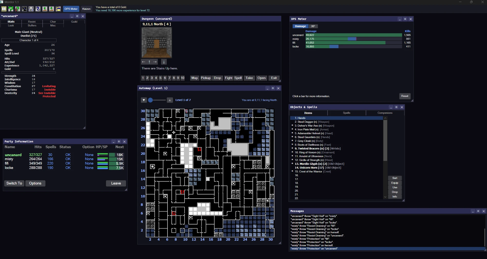
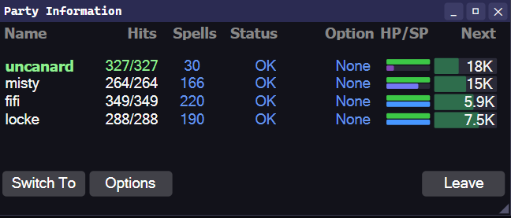
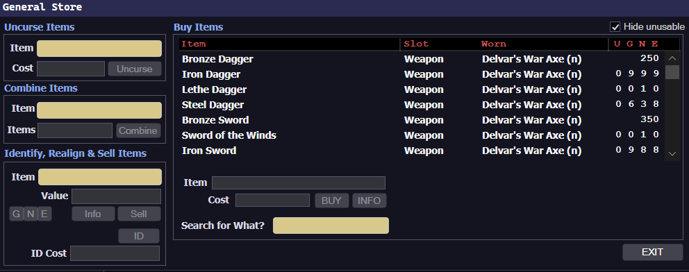
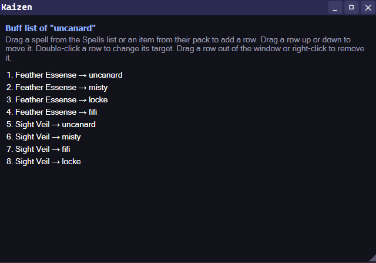
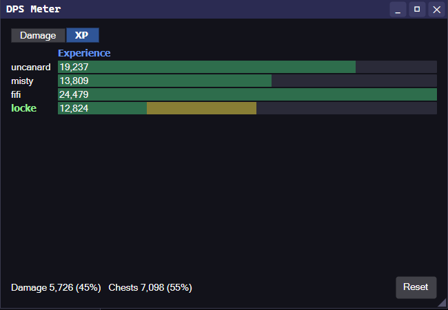
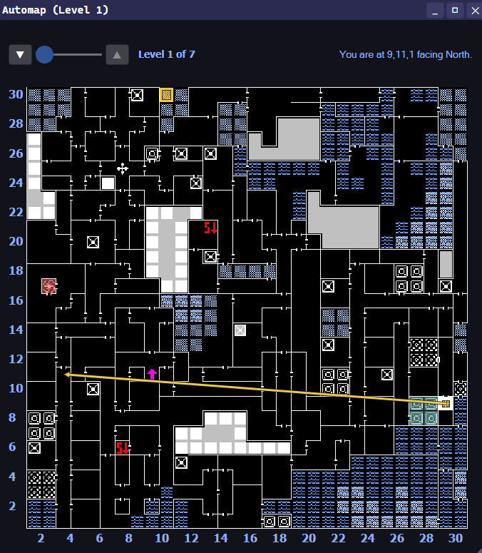

# OpenDejenol

OpenDejenol is a faithful engine for [**Mordor: The Depths of Dejenol**](https://www.decklinsdemise.com/mordor.htm) (MakeItSo Software, 1995):
a native Windows program that plays the original game from your own copy of it.

This project was born out of the increasing difficulty of being able to play the 1995 classic on modern hardware. The aim is to create an engine that can run the game as faithfully as possible without any emulation layers. While the base game is intended to be faithful, there is a modding system that allows developers to create quality-of-life and other mods to augment the base game.

This engine is built in C# using the Avalonia framework. It is almost entirely ported by LLMs (primarily Opus 5.5) via decompiled VB3 code and playtested by the creator. Very little of the code has been actually read or reviewed by hand.

## Mods

OpenDejenol comes bundled with a few mods. These include:

**Quality of Life** - Auto-management systems for party gold, enhanced UIs for party information and the store and such. No change to gameplay, no additional information that isn't already exposed.

 

**Kaizen** - Auto-cast a pre-set list of buffs every time the party enters the dungeon; auto-heal party members with all remaining unused SP when returning to town to prevent aging.

**DPS Meter** - Tracks damage dealt or XP gained.

**Cartographer** - Annotate the minimap to denote areas of interest and waypoints. Right-click squares to highlight them with a color, or link it to a destination square. Hover or click waypoints to interact with them.

**Auto-combat** - Gives each character's fight order every round by your own ordered rules: Fight, Defend, a combat spell or an item, and which monster group to aim at, chosen by the party's hits and spell points and the monster list as shown. Every order goes through the game's own keys and Cast; nothing the game hides (a monster's hits, an unidentified monster) is read.

**iCloud Saves** (macOS) - Copies your saves folder to iCloud Drive after the game saves, and offers a newer copy from another Mac at start. Whole-world snapshots, a backup before every restore, and a conflict is always your choice. Off by default; does nothing on Windows.

## Requirements

- Your own copy of Mordor: The Depths of Dejenol - the full version or the shareware. The full version can be purchased from [Decklin's Domain](https://www.decklinsdemise.com/mordor.htm) as `MordorSetup.exe`, and the free demo is `MordorDemoSetup.exe` from the same site. Those installers don't run on Windows 10 or 11, and you don't need to run them: OpenDejenol unpacks the game from the installer itself.
- 64-bit Windows 10 or 11, or macOS 12 or later on Apple Silicon (built from source; see below)

## Installing and running

Download the latest release from the [Releases page](https://github.com/uncanardnoir/open-dejenol/releases):

- **OpenDejenol.Game-win-Setup.exe** - the installer (64-bit Windows 10 or 11). It installs for your user only, needs no administrator rights or .NET, and adds Start-menu and desktop shortcuts. Uninstall it from Settings > Apps.
- **OpenDejenol.Game-win-Portable.zip** - unzip anywhere and run `OpenDejenol.exe`.

Releases aren't code-signed yet, so Windows may say "Windows protected your PC" the first time: choose More info, then Run anyway.

On first run, OpenDejenol looks for your Mordor. If it can't find one, choose **Use the installer...**
and pick the `MordorSetup.exe` (or `MordorDemoSetup.exe`) you downloaded - if it's in your Downloads
folder, OpenDejenol offers it. It unpacks the game into `%LOCALAPPDATA%\OpenDejenol\game`. A Mordor
already installed some other way can be chosen with **Locate Mordor...** instead. The choice is
remembered in `%APPDATA%\OpenDejenol`. When a newer version is out, it offers the
update on the main menu. To build it yourself instead, see [Building from source](#building-from-source).

## Building from source

- The .NET 8 SDK.
- `dotnet build src/Mordor.App -c Release` builds `src/Mordor.App/bin/Release/net8.0/OpenDejenol.exe`.
- `dotnet run --project src/Mordor.App` builds the Debug configuration and starts it.
- `MORDOR_GAMEDIR=<path to your Mordor folder> dotnet test` runs the test suites under standard
  test tooling (see `docs/TOOLS.md`).
- `sh tools/check.sh <path to your Mordor folder>` runs the checks (Git Bash or another POSIX
  shell). A few of them read material that is not in this repository and say
  "skipped: decompiled source not present"; that is expected.

### macOS

- The .NET 8 SDK and Xcode's command line tools (`codesign`, `iconutil`).
- `make mac-app` builds `dist/macos/OpenDejenol.app` for Apple Silicon, self-contained and signed
  ad hoc: it runs on the Mac that built it. Another Mac's Gatekeeper refuses an ad-hoc app, so it
  is not something to hand out; a release for others would need a Developer ID and notarisation,
  which are not set up.
- `make verify` builds as CI does; `make check GAME=<path to your Mordor folder>` runs the suites.
  `tools/check.sh` is Windows-only.
- Sound effects and music play through AudioToolbox, with no library added; the MIDI music uses
  macOS's built-in General MIDI synthesiser, so it sounds different from a Windows synthesiser.
- Known on Apple Silicon: Harmony patches do not apply, so a third-party mod that patches the game
  through `ctx.Harmony` is disabled there (the bundled mods use none), and a few pixel-exact window
  checks differ.

## Contributing
There are many ways to contribute:

**For non-developers:**

- If you notice a bug or something that is not faithful to the original game, please file an issue and I will take a look when I find time. I have done my best to playtest this game, but I have surely missed many things and have blind spots in my own playthrough.

- If you have an idea for a new mod, also file an issue and I will similarly take a look. With LLM-based programming, many mods are easy to create now!

**For developers:**

Please submit PRs! It is highly encouraged to use LLMs to understand and modify the codebase. Since this codebase was LLM-originated, it was not optimized for human readability. Please try to make any contributions reasonably high quality - test out changes as much as possible, ideally against the original version of the game. A decompiled version of the original game may help you in cross-checking details (getting your hands on such a decompiled version is left up to the reader). When opening a PR, please include what you did and how you validated - this will make things much easier for me to merge.

Feel free to create your own mods as well, and submit for PR. If they are of reasonable quality and taste (at my discretion), I will merge them in.

The only hardline rule I have for this project is that the base game **must be as faithful to the original as possible** (excepting UI look-and-feel that winforms provides - this is not a pixel-perfect recreation). Any changes to the game, even obvious bugfixes, must be done via a togglable mod.

There are other possible extensions to OpenDejenol - mobile versions (need to figure out layout issues) and cloud saves would be an interesting idea. C#/Avalonia run on Linux and macOS, so a port to those OSes should be possible with some work as well. I will probably not prioritize any of these in the near future, but would be quite interested if someone else wants to work on it!

## License

OpenDejenol is free software, released under the GNU General Public License, version 3 - see
[LICENSE](LICENSE).

Mordor: The Depths of Dejenol and its data remain the property of their owners and are not part of this project.

## Credits and thanks

Thank you to David Allen for creating Mordor, a big part of my childhood!